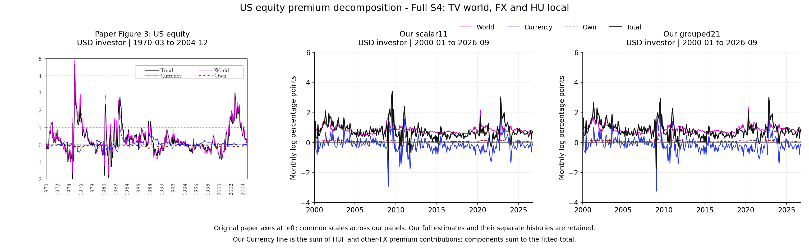
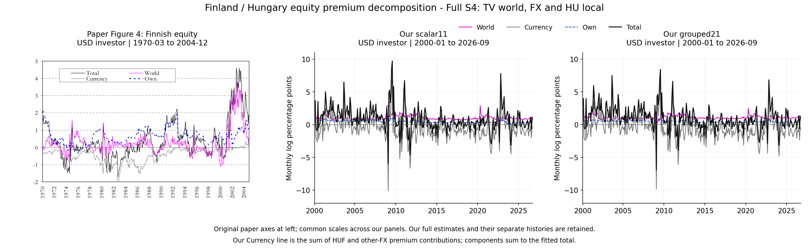

# International Asset Pricing and Currency Risk: Hungary

Research repository applying the ideas of Antell and Vaihekoski (2007) to Hungary.

Antell, J., & Vaihekoski, M. (2007). [International asset pricing models and currency risk: Evidence from Finland 1970–2004](https://www.researchgate.net/publication/222411851_International_asset_pricing_models_and_currency_risk_Evidence_from_Finland_1970-2004). *Journal of Banking & Finance, 31*(9), 2571–2590. [doi:10.1016/j.jbankfin.2006.09.013](https://doi.org/10.1016/j.jbankfin.2006.09.013).

## Paper charts beside our Hungarian results

**Click any chart to open the full-resolution PNG, then use your browser's image zoom.**

Left: the original paper chart. Centre: our scalar11 estimate. Right: our grouped21 estimate. These previews use **USD investors and full S4** (time-varying world, FX and Hungarian local risk prices), matching the paper's broad model structure. Each sample keeps its dates; the paper's original axes remain visible, while our panels share a scale.

**Figure 2 — Risk-price paths**

[](assets/paper-comparison/S4_USD_figure_2.png?raw=true)

**Figure 3 — US equity premium decomposition**

[](assets/paper-comparison/S4_USD_figure_3.png?raw=true)

**Figure 4 — Finnish versus Hungarian equity premium decomposition**

[](assets/paper-comparison/S4_USD_figure_4.png?raw=true)

Paper excerpts: printed pages 16–17 of the supplied April 2005 draft. Our premium charts combine the two FX contributions into the Currency line; risk-price charts show them separately. [Notebook 17](17_paper_chart_comparison.ipynb) also provides the final FX-only and EUR views. [Image provenance](assets/paper-comparison/manifest.json).

## Notebooks and setup

[Dataset notebook](dataset.ipynb): public data, USD/EUR perspectives, no dividend-yield predictor. The working snapshot is fixed to downloads on **2026-11-13**; `USE_LATEST = True` creates a separate fresh run. Keep the local `data/` folder to reproduce the original vintage; it is excluded from Git.

[First analysis notebook](02_analysis.ipynb): verify the frozen inputs, inspect returns, volatility and correlations, and run preliminary diagnostics. Run after the dataset notebook; analysis tables and figures are saved locally under `output/02_analysis/`.

[First pricing model](03_pricing_baseline.ipynb): joint constant world/local risk prices with a scalar BEKK covariance benchmark, robust QML uncertainty, and residual checks. Uses the same frozen sample in USD and EUR; outputs are saved under `output/03_pricing_baseline/`.

[Covariance comparison](04_covariance_comparison.ipynb): allow market-specific volatility dynamics with diagonal BEKK, keeping the same pricing equations and sample. Compare both models' fit, robust tests and residuals; run after notebook 03. Outputs are saved under `output/04_covariance_comparison/`.

[Currency-risk pricing](05_currency_risk.ipynb): jointly estimate constant world, local and two FX risk prices for USD and EUR investors, with separate FX forecasting equations. Compare zero/estimated FX prices within scalar and diagonal BEKK systems on the frozen sample; outputs are saved under `output/05_currency_risk/`.

[Time-varying world risk](06_time_varying_world.ipynb): audit the lagged global instruments, then compare constant and instrument-dependent world risk prices for USD and EUR. Local and FX prices remain time-constant; run after notebook 05. Outputs are saved under `output/06_time_varying_world/`.

[Time-varying currency risk](07_time_varying_currency.ipynb): audit global, inflation and Hungary-regime conditioners, then allow both currency prices to vary for USD and EUR investors. The world price stays time-varying and local prices stay constant; run after notebook 06. Outputs are saved under `output/07_time_varying_currency/`.

[Specification and robustness audit](08_specification_audit.ipynb): compare the paper's currency-mean restriction with VAR forecasting, test a nested FX-mean correction and grouped covariance dynamics, and run matched instrument/window sensitivities. Run after notebook 07; the reusable likelihood implementation is in [pricing_robustness.py](pricing_robustness.py). Outputs are saved under `output/08_specification_audit/`.

[Covariance robustness](09_covariance_robustness.ipynb): retain the paper-style FX means, compare diagonal and two-shock-lag covariance extensions, and report fixed score-HAC bandwidths alongside residual diagnostics. Run after notebook 08; the extension is in [covariance_robustness.py](covariance_robustness.py). Outputs are saved under `output/09_covariance_robustness/`.

[Time-varying Hungarian local risk](10_time_varying_local.ipynb): audit the local inflation/regime conditioners, then compare constant and time-varying Hungarian local prices for USD and EUR under both retained covariance models. Keep world/FX instruments fixed and report a gap-level sensitivity and all four HAC bandwidths. Run after notebook 09; the extension is in [local_risk_pricing.py](local_risk_pricing.py). Outputs are saved under `output/10_time_varying_local/`.

[Pricing-error intercepts](11_pricing_errors.ipynb): jointly estimate World, US and Hungarian equity alphas for USD and EUR under both retained covariance models. Test all three alphas jointly zero, report individual uncertainty and all four HAC bandwidths, and revisit risk pricing with a time-varying-local sensitivity. Run after notebook 10; the extension is in [pricing_error_tests.py](pricing_error_tests.py). Outputs are saved under `output/11_pricing_errors/`.

[Consistent final model comparison](12_final_model_comparison.ipynb): compare four nested pricing stages for USD and EUR using corrected FX means, zero alphas, the frozen sample and both retained covariance models. Recheck earlier estimates from nested starts, then report aligned AIC/BIC rankings, incremental robust tests and diagnostics. Run after notebook 11; outputs are saved under `output/12_final_model_comparison/`.

[Constant world/local, time-varying FX](13_time_varying_FX_only.ipynb): fit the parsimonious FX-only time-variation branch for USD and EUR under both retained covariance models. Keep corrected FX means and zero alphas; compare with the all-constant and world/FX models and update the full AIC/BIC catalog. Run after notebook 12; outputs are saved under `output/13_time_varying_FX_only/`.

[Targeted FX robustness](14_FX_targeted_robustness.ipynb): check inflation timing/form, regime dependence, direct US-CPI predictors and calendar-block influence for the FX-only model. Retain all frozen months in the GARCH recursion, distinguish zero likelihood weights from removed observations, and report all fixed checks for USD/EUR and both covariance models. Run after notebook 13; the weighted-objective extension is in [fx_robustness.py](fx_robustness.py). Outputs are saved under `output/14_FX_targeted_robustness/`.

[Covariance-targeting sensitivity](15_covariance_targeting.ipynb): compare the FX-only free covariance intercept with a preliminary innovation-moment target and a centered-return covariance benchmark for USD/EUR and both retained models. Enforce positive intercepts and propagate estimated-target uncertainty through stacked estimating equations at all four HAC bandwidths. Uses notebook 13 references and the same frozen sample; the extension is in [covariance_targeting.py](covariance_targeting.py). Outputs are saved under `output/15_covariance_targeting/`.

[Final research synthesis](16_research_synthesis.ipynb): consolidate USD/EUR model rankings, pricing tests, every archived robustness family, numerical failures and Hungarian premium decompositions. Keep corrected FX means, zero alphas and both retained covariance models in the main results; label historical alternatives by scope. Run after notebooks 02–15 in base. [research_synthesis_inputs.json](research_synthesis_inputs.json) pins the local inputs; the synthesis does not refit or fetch data. Outputs are saved under `output/16_research_synthesis/`.

[Paper chart comparison](17_paper_chart_comparison.ipynb): place Figures 2–4 from printed pages 16–17 of the supplied paper beside our scalar11/grouped21 charts. Includes full S4 and final FX-only views for USD/EUR, with each sample's dates and axes retained. Uses saved estimates and the local PDF excerpt assets; no fitting or fetching. The switchable gallery and plotted series are saved under `output/17_paper_chart_comparison/`.

Use the existing Miniconda **base** kernel in VS Code or Jupyter. From this directory, with base active:

```sh
python -m pip install -r requirements.txt
```

The notebooks record the active package versions and do not require a custom kernel. For the pandas 3 / old statsmodels import error, run `%pip install --upgrade statsmodels==0.15.0` in the existing notebook, then **Restart Kernel and Run All**. The original downloaded snapshot retains its own provenance and package-version record.
