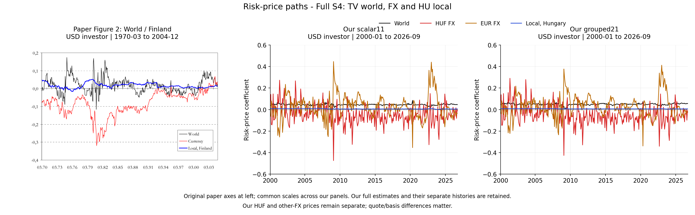
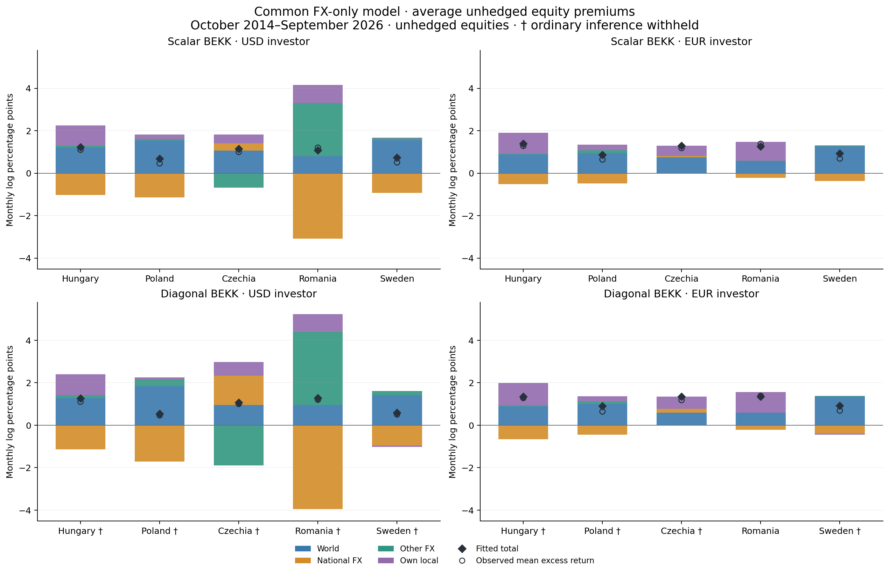

# International Asset Pricing and Currency Risk: Hungary

Research repository applying the ideas of Antell and Vaihekoski (2007) to Hungary.

Antell, J., & Vaihekoski, M. (2007). [International asset pricing models and currency risk: Evidence from Finland 1970–2004](https://www.researchgate.net/publication/222411851_International_asset_pricing_models_and_currency_risk_Evidence_from_Finland_1970-2004). *Journal of Banking & Finance, 31*(9), 2571–2590. [doi:10.1016/j.jbankfin.2006.09.013](https://doi.org/10.1016/j.jbankfin.2006.09.013).

## Paper charts beside our Hungarian results

**Click any chart to open the full-resolution PNG, then use your browser's image zoom.**

Left: the original paper chart. Centre: our scalar11 estimate. Right: our grouped21 estimate. These previews use **USD investors and full S4** (time-varying world, FX and Hungarian local risk prices), matching the paper's broad model structure. Each sample keeps its dates; the paper's original axes remain visible, while our panels share a scale.

**Figure 2 — Risk-price paths**

[](assets/paper-comparison/S4_USD_figure_2.png?raw=true)

**Figure 3 — US equity premium decomposition**

[](assets/paper-comparison/S4_USD_figure_3.png?raw=true)

**Figure 4 — Finnish versus Hungarian equity premium decomposition**

[](assets/paper-comparison/S4_USD_figure_4.png?raw=true)

Paper excerpts: printed pages 16–17 of the supplied April 2005 draft. Our premium charts combine the two FX contributions into the Currency line; risk-price charts show them separately. [Notebook 17](17_paper_chart_comparison.ipynb) also provides the final FX-only and EUR views. [Image provenance](assets/paper-comparison/manifest.json).

## Unhedged regional comparison

Hungary, Poland, Czechia, Romania and Sweden on the same **October 2014–September 2026** sample, for **USD/EUR investors**. The estimates, targeted robustness checks and covariance-targeting sensitivity are complete through notebook 32. The inference limitations below remain part of the research findings.

[](assets/regional-comparison/01_unhedged_mean_comparison.svg?raw=true)

**Click for a zoomable SVG.** Four components: world, national FX, other FX and own local risk. The common FX-only specification keeps world/local prices constant and FX prices time-varying; both covariance models and their numerical inference flags remain visible. These are model-implied monthly excess-return contributions, averaged from monthly price × covariance products. They do not measure hedging costs.

The average national-FX contribution is negative for Hungary, Poland, Romania and Sweden in both investor perspectives; Czechia differs and is more specification-sensitive. Read the two FX contributions together: large opposing components can produce a much smaller net currency contribution. BIC selects the simpler all-constant scalar benchmark in all ten country/investor cases; the FX-only charts provide a common specification comparison.

**Reading the withheld results.** † means ordinary standard errors and Wald p-values are withheld; the estimated parameters and premium paths remain visible. It does not mean missing data, zero risk premia or a rejected hypothesis. In the diagonal fits, parameter bounds and unstable likelihood curvature often prevent reliable ordinary inference; targeted fits also commonly reach the positive-definite intercept boundary.

| Comparison | Scalar: usable ordinary inference | Diagonal: usable ordinary inference |
| --- | ---: | ---: |
| Common FX-only free-intercept model | 10 / 10 | 1 / 10 |
| Two covariance-target sensitivities combined | 20 / 20 | 2 / 20 |

All ten BIC-selected S1/scalar fits pass the numerical inference checks. Scalar results provide the current basis for ordinary pricing tests; flagged diagonal decompositions are descriptive sensitivity estimates. Passing these checks does not establish correct model specification. Agreement in point-estimate signs across models does not establish statistical significance or a causal currency drag. [Per-fit flags and reasons](assets/regional-comparison/FX_only_average_premiums.csv).

[Full comparison and economic interpretation](assets/regional-comparison/README.md) · [Offline interactive viewer](assets/regional-comparison/regional_comparison.html) · [Constant-price benchmark](assets/regional-comparison/03_constant_price_benchmark.svg?raw=true)

| Investor | Common time series: scalar BEKK | Common time series: diagonal BEKK |
| --- | --- | --- |
| USD | [Zoomable decomposition](assets/regional-comparison/02_unhedged_USD_scalar.svg?raw=true) | [Zoomable decomposition](assets/regional-comparison/02_unhedged_USD_diagonal.svg?raw=true) |
| EUR | [Zoomable decomposition](assets/regional-comparison/02_unhedged_EUR_scalar.svg?raw=true) | [Zoomable decomposition](assets/regional-comparison/02_unhedged_EUR_diagonal.svg?raw=true) |

Download/open the HTML locally to use its controls; it embeds all 140 catalog/target comparison cases and needs no external resources. The gallery includes full-precision CSVs and [provenance](assets/regional-comparison/manifest.json). Keep the local ignored `data/` and `output/` folders for exact frozen-vintage reruns.

## Notebooks and setup

[Dataset notebook](dataset.ipynb): public data, USD/EUR perspectives, no dividend-yield predictor. The working snapshot is fixed to downloads on **2026-11-13**; `USE_LATEST = True` creates a separate fresh run. Keep the local `data/` folder to reproduce the original vintage; it is excluded from Git.

[First analysis notebook](02_analysis.ipynb): verify the frozen inputs, inspect returns, volatility and correlations, and run preliminary diagnostics. Run after the dataset notebook; analysis tables and figures are saved locally under `output/02_analysis/`.

[First pricing model](03_pricing_baseline.ipynb): joint constant world/local risk prices with a scalar BEKK covariance benchmark, robust QML uncertainty, and residual checks. Uses the same frozen sample in USD and EUR; outputs are saved under `output/03_pricing_baseline/`.

[Covariance comparison](04_covariance_comparison.ipynb): allow market-specific volatility dynamics with diagonal BEKK, keeping the same pricing equations and sample. Compare both models' fit, robust tests and residuals; run after notebook 03. Outputs are saved under `output/04_covariance_comparison/`.

[Currency-risk pricing](05_currency_risk.ipynb): jointly estimate constant world, local and two FX risk prices for USD and EUR investors, with separate FX forecasting equations. Compare zero/estimated FX prices within scalar and diagonal BEKK systems on the frozen sample; outputs are saved under `output/05_currency_risk/`.

[Time-varying world risk](06_time_varying_world.ipynb): audit the lagged global instruments, then compare constant and instrument-dependent world risk prices for USD and EUR. Local and FX prices remain time-constant; run after notebook 05. Outputs are saved under `output/06_time_varying_world/`.

[Time-varying currency risk](07_time_varying_currency.ipynb): audit global, inflation and Hungary-regime conditioners, then allow both currency prices to vary for USD and EUR investors. The world price stays time-varying and local prices stay constant; run after notebook 06. Outputs are saved under `output/07_time_varying_currency/`.

[Specification and robustness audit](08_specification_audit.ipynb): compare the paper's currency-mean restriction with VAR forecasting, test a nested FX-mean correction and grouped covariance dynamics, and run matched instrument/window sensitivities. Run after notebook 07; the reusable likelihood implementation is in [pricing_robustness.py](pricing_robustness.py). Outputs are saved under `output/08_specification_audit/`.

[Covariance robustness](09_covariance_robustness.ipynb): retain the paper-style FX means, compare diagonal and two-shock-lag covariance extensions, and report fixed score-HAC bandwidths alongside residual diagnostics. Run after notebook 08; the extension is in [covariance_robustness.py](covariance_robustness.py). Outputs are saved under `output/09_covariance_robustness/`.

[Time-varying Hungarian local risk](10_time_varying_local.ipynb): audit the local inflation/regime conditioners, then compare constant and time-varying Hungarian local prices for USD and EUR under both retained covariance models. Keep world/FX instruments fixed and report a gap-level sensitivity and all four HAC bandwidths. Run after notebook 09; the extension is in [local_risk_pricing.py](local_risk_pricing.py). Outputs are saved under `output/10_time_varying_local/`.

[Pricing-error intercepts](11_pricing_errors.ipynb): jointly estimate World, US and Hungarian equity alphas for USD and EUR under both retained covariance models. Test all three alphas jointly zero, report individual uncertainty and all four HAC bandwidths, and revisit risk pricing with a time-varying-local sensitivity. Run after notebook 10; the extension is in [pricing_error_tests.py](pricing_error_tests.py). Outputs are saved under `output/11_pricing_errors/`.

[Consistent final model comparison](12_final_model_comparison.ipynb): compare four nested pricing stages for USD and EUR using corrected FX means, zero alphas, the frozen sample and both retained covariance models. Recheck earlier estimates from nested starts, then report aligned AIC/BIC rankings, incremental robust tests and diagnostics. Run after notebook 11; outputs are saved under `output/12_final_model_comparison/`.

[Constant world/local, time-varying FX](13_time_varying_FX_only.ipynb): fit the parsimonious FX-only time-variation branch for USD and EUR under both retained covariance models. Keep corrected FX means and zero alphas; compare with the all-constant and world/FX models and update the full AIC/BIC catalog. Run after notebook 12; outputs are saved under `output/13_time_varying_FX_only/`.

[Targeted FX robustness](14_FX_targeted_robustness.ipynb): check inflation timing/form, regime dependence, direct US-CPI predictors and calendar-block influence for the FX-only model. Retain all frozen months in the GARCH recursion, distinguish zero likelihood weights from removed observations, and report all fixed checks for USD/EUR and both covariance models. Run after notebook 13; the weighted-objective extension is in [fx_robustness.py](fx_robustness.py). Outputs are saved under `output/14_FX_targeted_robustness/`.

[Covariance-targeting sensitivity](15_covariance_targeting.ipynb): compare the FX-only free covariance intercept with a preliminary innovation-moment target and a centered-return covariance benchmark for USD/EUR and both retained models. Enforce positive intercepts and propagate estimated-target uncertainty through stacked estimating equations at all four HAC bandwidths. Uses notebook 13 references and the same frozen sample; the extension is in [covariance_targeting.py](covariance_targeting.py). Outputs are saved under `output/15_covariance_targeting/`.

[Final research synthesis](16_research_synthesis.ipynb): consolidate USD/EUR model rankings, pricing tests, every archived robustness family, numerical failures and Hungarian premium decompositions. Keep corrected FX means, zero alphas and both retained covariance models in the main results; label historical alternatives by scope. Run after notebooks 02–15 in base. [research_synthesis_inputs.json](research_synthesis_inputs.json) pins the local inputs; the synthesis does not refit or fetch data. Outputs are saved under `output/16_research_synthesis/`.

[Paper chart comparison](17_paper_chart_comparison.ipynb): place Figures 2–4 from printed pages 16–17 of the supplied paper beside our scalar11/grouped21 charts. Includes full S4 and final FX-only views for USD/EUR, with each sample's dates and axes retained. Uses saved estimates and the local PDF excerpt assets; no fitting or fetching. The switchable gallery and plotted series are saved under `output/17_paper_chart_comparison/`.

[Risk prices, covariances and premium signs](18_risk_price_covariance_signs.ipynb): inspect each monthly price × covariance product for Hungarian and US equities, keeping the two FX contributions separate. Covers full S4 and FX-only, USD/EUR and both retained covariance models; checks signs and saved pricing means without fitting or fetching. Monthly terms, sign summaries and charts are saved under `output/18_risk_price_covariance_signs/`.

[Regional data audit](19_regional_data_audit.ipynb): freeze open total-return data for Poland (WIG), Czechia (PX-TR), Romania (BET-TR) and Sweden (OMXSGI), with unhedged USD/EUR views ending September 2026. National downloads use the 16 November vintage and reuse Hungary's locked global inputs. Preserve each available history and a matched October 2014–September 2026 sample including Hungary; audit missing data, back-calculated history, month-end dates, conversion identities and candidate instruments. The public Romanian closing feed does not expose its documented 2012 back-history. [regional_dataset_inputs.json](regional_dataset_inputs.json) pins the local snapshot under `data/regional_fixed_2026-11-16_end_2026-09/`.

[Regional initial diagnostics](20_regional_diagnostics.ipynb): compare Poland, Czechia, Romania and Sweden with Hungary for USD/EUR investors on the same October 2014–September 2026 window, retaining separate available-history summaries. Verify the frozen inputs, inspect returns, FX paths, volatility and correlations, and screen serial dependence, ARCH effects, predictor persistence and instrument rank. Report raw and Holm-adjusted return-test p-values without fitting pricing models or fetching data. Use the existing base kernel; tables and five charts are saved under `output/20_regional_diagnostics/fixed_2026-09/`.

[Regional constant-price baseline](21_regional_pricing_baseline.ipynb): jointly fit World, US and national equity returns for Poland, Czechia, Romania, Sweden and Hungary in USD/EUR on the same frozen October 2014–September 2026 sample. Refit Hungary on that window; compare world-only and constant world/local prices with the scalar BEKK benchmark from notebook 03. Check gradients, multiple starts, curvature, robust QML and fixed score-HAC sensitivities, then compare premium components and residual adequacy. Explicit FX pricing is deferred. Use base; the reusable engine is [regional_pricing_baseline.py](regional_pricing_baseline.py), and local results are saved under `output/21_regional_pricing_baseline/2014-10_2026-09/`.

[Regional covariance sensitivity](22_regional_covariance_sensitivity.ipynb): compare the 20 unchanged scalar references from notebook 21 with 20 diagonal BEKK fits for all five countries in USD/EUR, keeping the frozen 144-month common sample and constant pricing restrictions. Verify exact scalar nesting and gradients; compare AIC/BIC, local-price and common-dynamics tests, premium contributions, residual screens and numerical inference flags at all four fixed score-HAC bandwidths. Use base; [regional_covariance_sensitivity.py](regional_covariance_sensitivity.py) contains the reusable diagonal engine, with results under `output/22_regional_covariance_sensitivity/2014-10_2026-09/`.

[Regional currency risk](23_regional_currency_risk.ipynb): jointly price World, US, national equity and two independent FX factors for all five countries in USD/EUR on the same frozen 144-month sample. Compare zero/free constant FX prices under scalar and diagonal BEKK with corrected paper-style FX means and zero equity alphas. Audit factor rank, exact nesting, gradients, multiple starts, robust QML/HAC tests, residuals and world/FX/local premium contributions; suppress invalid numerical inference. No fetching or base-kernel changes. [regional_currency_pricing.py](regional_currency_pricing.py) reuses the verified priced-mean filter; results are saved under `output/23_regional_currency_risk/2014-10_2026-09/`.

[Regional time-varying world risk](24_regional_time_varying_world.ipynb): first reconstruct and audit the lagged global instruments from frozen FRED observations, including persistence, rank and leverage on the common 144-month window. Compare constant and conditional world prices for all five countries in USD/EUR under scalar and diagonal BEKK, retaining corrected FX means, zero alphas and constant FX/local prices. Report robust QML/HAC tests, pointwise price intervals, premium decompositions and numerical/residual flags. Use base; [regional_world_pricing.py](regional_world_pricing.py) contains the extension, and outputs are saved in a separate instrument-configuration folder under `output/24_regional_time_varying_world/2014-10_2026-09/`.

[Regional time-varying currency risk](25_regional_time_varying_currency.ipynb): audit frozen inflation-gap levels/changes, timing, inherited US-inflation carry, regimes, rank and leverage before allowing both FX prices to vary. Compare all five countries in USD/EUR on the same 144 months under scalar and diagonal BEKK, keeping notebook 24's world design, corrected five-series means, zero alphas and constant local prices. Report joint/separate FX constancy tests, full zero-price-function tests, all four QML/HAC bandwidths, pointwise price paths, premium products and numerical/residual flags. Use base; [regional_fx_price_variation.py](regional_fx_price_variation.py) contains the extension, with separate configuration folders under `output/25_regional_time_varying_currency/2014-10_2026-09/`.

[Regional time-varying local risk](26_regional_time_varying_local.ipynb): audit lagged national inflation-gap changes/levels, inherited inflation carry, varying regimes and joint mean-loading rank before adding national local-price slopes. Compare Poland, Czechia, Romania and Sweden with Hungary in USD/EUR on the same frozen 144 months under scalar and diagonal BEKK. Keep notebook 25's world/FX designs, corrected five-series means, zero alphas and constant US local price; jointly re-estimate all free parameters. Report local constancy/zero-function tests at four QML/HAC bandwidths, price paths, premium products, residual diagnostics and numerical flags. The optional local gap-level setting creates a separate configuration. Use base; [regional_local_pricing.py](regional_local_pricing.py) contains the extension, with local results under `output/26_regional_time_varying_local/2014-10_2026-09/`.

[Regional equity pricing errors](27_regional_pricing_errors.ipynb): jointly free World, US and national equity intercepts for all five countries in USD/EUR under scalar and diagonal BEKK on the same frozen 144 months. Use constant local prices as the common main comparison and notebook 26's time-varying local design as a sensitivity. Keep corrected FX means and all conditioning designs fixed; compare 40 free-alpha fits with 40 zero-alpha references. Report robust three-df joint zero-alpha tests, individual monthly-pp alphas with Holm adjustments, all four HAC bandwidths, residual diagnostics and numerical flags. Keep pricing errors separate from risk-premium contributions. Use base; [regional_pricing_errors.py](regional_pricing_errors.py) contains the extension, with results under `output/27_regional_pricing_errors/2014-10_2026-09/`.

[Consistent final regional model comparison](28_regional_final_model_comparison.ipynb): compare the four nested zero-alpha pricing stages for all five countries in USD/EUR under scalar and diagonal BEKK on the same frozen 144 months. Verify all 80 corrected five-series references, test feasible cross-stage mappings and refine only demonstrated improvements in a separate output folder. Recompute matched AIC/BIC ranks, incremental and full price-function tests at four QML/HAC bandwidths, residual diagnostics and premium decompositions. Keep numerical flags beside every criterion winner. Uses the existing [regional_local_pricing.py](regional_local_pricing.py) engine and base kernel; results are saved under `output/28_regional_final_model_comparison/2014-10_2026-09/`.

[Regional FX-only time variation](29_regional_time_varying_FX_only.ipynb): estimate constant world/local prices and time-varying national/other FX prices for Poland, Czechia, Romania, Sweden and Hungary in USD/EUR under scalar and diagonal BEKK. Keep the frozen October 2014–September 2026 sample, exact inherited FX instruments, corrected means and zero alphas. Add 20 fits to notebook 28's 80 verified references; audit feasible mappings and preserve earlier outputs. Compare ten matched candidates per country/investor, report FX constancy and full zero-function tests at four QML/HAC bandwidths, and test the world-constancy restriction in unrestricted S3. Include FX price charts, premium products, residual/numerical flags and a final summary. Reuses [regional_local_pricing.py](regional_local_pricing.py) and base; results are saved under `output/29_regional_time_varying_FX_only/2014-10_2026-09/`.

[Regional FX-only targeted robustness](30_regional_FX_targeted_robustness.ipynb): audit inflation timing, national gap levels, regime removal, direct US-CPI predictors, carried-CPI dates and 2020/2022–23 likelihood influence for all five countries in USD/EUR, under scalar and diagonal BEKK. Keep the frozen 144-month common sample, base kernel, corrected FX means, constant world/local prices and zero alphas. Preserve all state updates when calendar likelihood weights are zero; report full-calendar QML/HAC tests, price/premium sensitivity, residual diagnostics and numerical failures. Record regime-removal aliases outside Czechia and the inapplicable 2008–09 block explicitly. Uses [regional_fx_robustness.py](regional_fx_robustness.py), with exact fit/Hessian caches and a final summary under `output/30_regional_FX_targeted_robustness/2014-10_2026-09/`.

[Regional covariance-targeting sensitivity](31_regional_covariance_targeting.ipynb): compare 20 free-intercept references with 40 innovation-moment/centered-return targeted fits across all five countries, USD/EUR and scalar/diagonal BEKK. Keep the frozen 144 months, base kernel, corrected FX means and zero alphas. Verify the target map, analytic derivatives, positive-intercept constraints and full PSD-cone KKT certificates; propagate estimated-target uncertainty at all four HAC bandwidths and withhold invalid ordinary inference. Preserve earlier references and exact fit/derivative caches. The extension is [regional_covariance_targeting.py](regional_covariance_targeting.py), with results under `output/31_regional_covariance_targeting/2014-10_2026-09/`.

[Final regional research synthesis](32_regional_research_synthesis.ipynb): consolidate the 100-model joint catalog, 160 instrument/influence cases and 60 covariance-targeting cases on the common sample. Compare unhedged regional decompositions with separate national/other FX terms, pricing identities, criterion winners, all archived robustness evidence, S3/S4 alpha tests and numerical/residual flags. Export six PNG/SVG figure pairs, a zoomable Markdown gallery and a self-contained interactive viewer. [regional_research_synthesis_inputs.json](regional_research_synthesis_inputs.json) pins the source chain; [regional_comparison.py](regional_comparison.py) builds the figures. No fetching or fitting; use base. Local evidence tables are saved under `output/32_regional_research_synthesis/2014-10_2026-09/` and shareable comparisons under [assets/regional-comparison](assets/regional-comparison/README.md).

Use the existing Miniconda **base** kernel in VS Code or Jupyter. From this directory, with base active:

```sh
python -m pip install -r requirements.txt
```

The notebooks record the active package versions and do not require a custom kernel. For the pandas 3 / old statsmodels import error, run `%pip install --upgrade statsmodels==0.15.0` in the existing notebook, then **Restart Kernel and Run All**. The original downloaded snapshot retains its own provenance and package-version record.
