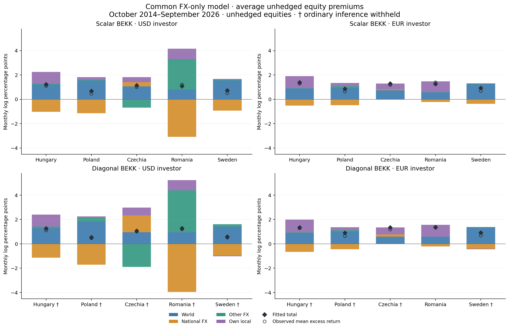

# Unhedged regional equity premium comparison

Frozen October 2014–September 2026 · 144 common months · USD/EUR · base kernel.

Click the chart for a zoomable SVG. World, national FX, other FX and own-local bars are average monthly price × covariance contributions; units are monthly log percentage points. Diamonds are fitted totals and hollow circles observed mean excess returns. † marks withheld ordinary parameter/risk-price inference; bars have no confidence intervals.

The comparison keeps the same FX-only specification in every country. BIC selects the all-constant scalar S1 benchmark in all ten country/investor cases; see the [separate S1 chart](03_constant_price_benchmark.svg?raw=true).

Average national-FX contributions (scalar BEKK):

| Country | USD investor | EUR investor |
| --- | ---: | ---: |
| Hungary | -1.025 | -0.508 |
| Poland | -1.135 | -0.484 |
| Czechia | +0.351 | +0.064 |
| Romania | -3.088 | -0.213 |
| Sweden | -0.926 | -0.371 |

The average national-FX contribution is negative for Hungary, Poland, Romania and Sweden in both perspectives and both retained covariance models. This sign survives the archived instrument/influence and covariance-target point estimates for those four countries; magnitudes change and irregular fits remain flagged.

Czechia has positive national-FX contributions in the main reference. The sign is sensitive to some specifications, particularly EUR instruments and diagonal targeting. Its USD total currency contribution is negative because the other-FX contribution outweighs the positive national-FX contribution.

Romania/USD illustrates offsetting currency components: national FX -3.088 plus other FX +2.504 gives total FX -0.584 monthly log pp in the scalar reference. Interpreting the national term alone overstates the net negative currency contribution.

Hungary has a sizable positive own-local contribution; Poland's is smaller, and Sweden's is close to zero in the scalar reference and slightly negative in the diagonal reference. These are model-dependent expected-return components, with no direct hedged-investment interpretation.

Sweden's scalar FX-constancy result is the clearest time-variation signal, especially in EUR; target-adjusted results retain it, while several instrument/influence and bandwidth checks weaken the baseline evidence. Avoid a universal claim that FX prices vary across the region.

Three-row time paths (world / total currency / own local):

| Investor | Scalar BEKK | Diagonal BEKK |
| --- | --- | --- |
| USD | [Zoomable chart](02_unhedged_USD_scalar.svg?raw=true) | [Zoomable chart](02_unhedged_USD_diagonal.svg?raw=true) |
| EUR | [Zoomable chart](02_unhedged_EUR_scalar.svg?raw=true) | [Zoomable chart](02_unhedged_EUR_diagonal.svg?raw=true) |

Thin lines are monthly; thick lines are trailing 12-month averages. Total currency combines national FX and other FX. The five country columns share dates and each row shares a scale.

[Download the interactive comparison](regional_comparison.html): open the file locally in a browser to switch investor, covariance, pricing model and country. It embeds 140 cases and needs no external resources. GitHub's file view does not execute the controls.

[Full-precision average table](FX_only_average_premiums.csv) · [Monthly products](FX_only_monthly_premiums.csv) · [Separate price/covariance terms](price_covariance_terms.csv) · [Provenance](manifest.json)

[Notebook 31](../../31_regional_covariance_targeting.ipynb) completes 40 targeted fits plus 20 free references. [Notebook 32](../../32_regional_research_synthesis.ipynb) consolidates the model catalog, all archived regional robustness checks, regularity flags and pricing adequacy. It verifies the locked local data/results and rebuilds this gallery without fetching or fitting. Keep the ignored local data/ and output/ folders for the exact vintage.

These are descriptive unhedged pricing decompositions. They do not identify forward carry, hedging costs or a causal economic drag.
